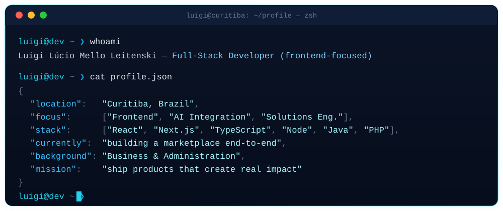

  

  
  &nbsp;
  

## `~/about-me`

  

I'm **Luigi**, a Full-Stack Developer from **Curitiba, Brazil** — frontend-focused, but comfortable across the whole stack. I care about the details users *feel*: smooth motion, accessible UI and interfaces that just work.

| ⚡ What I do | 🧭 How I think |
| :-- | :-- |
| Build **modern, accessible interfaces** with React, Next.js & Motion | Listen to the **business problem first**, then design the technical answer |
| Integrate **AI & LLMs** into real products and automate workflows | Background in **Business & Administration** — strategy meets execution |
| Ship **end-to-end** — from design system to deploy | Obsessed with **UX, design tokens and pixel-level polish** |

  
<b>▸ Expand for more</b>

   

  - 🚀 Currently building a **marketplace product** end-to-end with a small team
  - 🌱 Going deeper into **AI agents, automation workflows and system design**
  - 💬 Ask me about **React, Next.js, TypeScript or AI integrations**
  - 🎮 Off the keyboard: sports, games and good music

## `~/tech-stack`

<table>
  <tr>
    <td align="center" width="25%"><b>🎨 Frontend</b></td>
    <td> HTML · CSS · JavaScript · TypeScript · React · Next.js · Motion</td>
  </tr>
  <tr>
    <td align="center"><b>⚙️ Backend</b></td>
    <td> Node.js · Java · PHP · TypeScript · REST APIs</td>
  </tr>
  <tr>
    <td align="center"><b>🤖 AI & Automation</b></td>
    <td>
      
      
      
      
    </td>
  </tr>
  <tr>
    <td align="center"><b>🧰 Tools</b></td>
    <td></td>
  </tr>
</table>

## `~/github-analytics`

  
  

  

  

## `~/connect`

  
  
  
  

  

  

